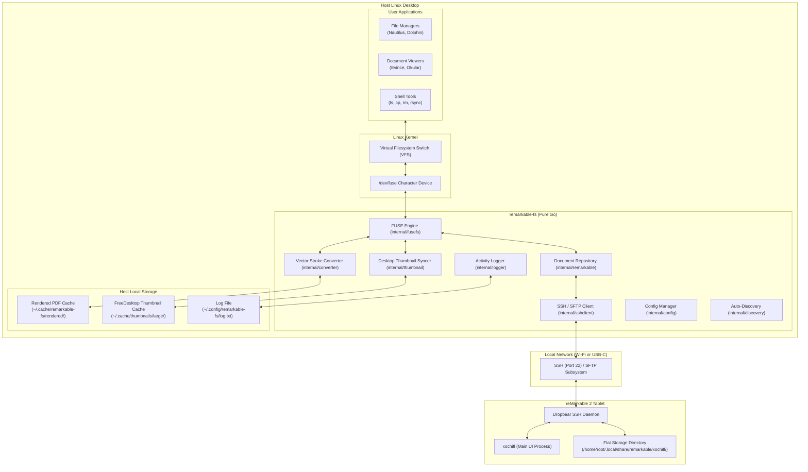
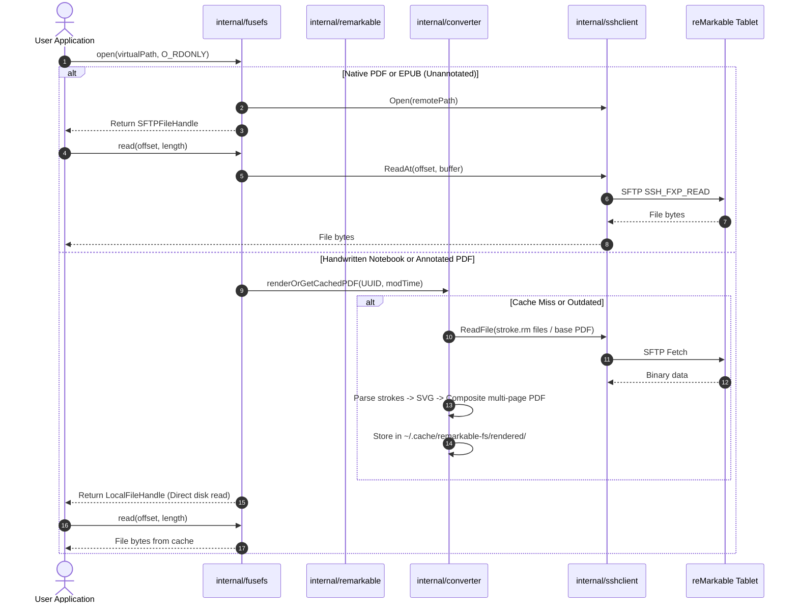
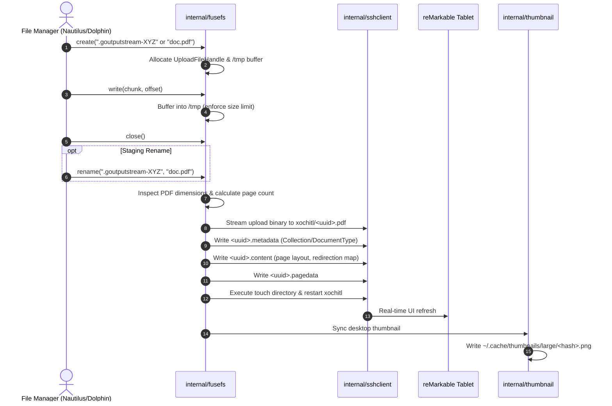
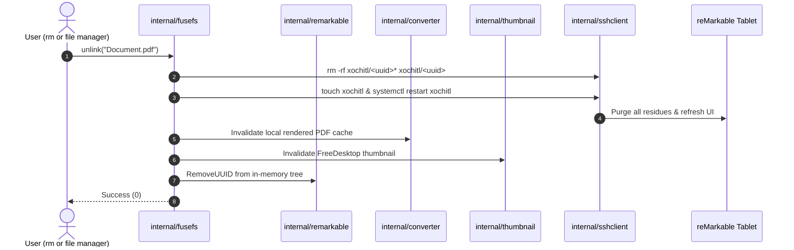

# Application Architecture & Component Overview

This document provides a high-level architectural overview of `remarkable-fs`, describing the primary subsystems, their responsibilities, and how data flows across the system boundaries without delving into line-by-line implementation details.

---

## 1. System Topology

`remarkable-fs` sits entirely in userspace on the host computer. It acts as an intelligent translator between the Linux kernel's Virtual Filesystem (VFS) and the reMarkable tablet over standard network protocols.

---

## 2. Core Architectural Subsystems

### 2.1. CLI & Lifecycle Orchestrator ([`cmd/remarkable-fs`](../cmd/remarkable-fs/main.go))
The entrypoint coordinates application startup, configuration precedence, transport discovery, mount setup, and signal trapping:
- Loads configuration settings from YAML and merges command-line arguments.
- Truncates and initializes the user activity log.
- Executes device discovery if no explicit host is provided.
- Establishes the authenticated SSH/SFTP connection to the tablet.
- Launches background sleep-prevention routines if enabled.
- Mounts the FUSE filesystem at the target directory.
- Captures termination signals (`SIGINT`, `SIGTERM`) to trigger an orderly FUSE unmount before process exit.

### 2.2. Configuration Management ([`internal/config`](../internal/config/config.go))
Manages persistent settings in `~/.config/remarkable-fs/configuration.yaml`:
- Persists user preferences (preferred host, fallback IP list, mount point, upload size limits).
- Provides type-safe accessors and fallback defaults.
- Automatically creates standard configuration files if absent.

### 2.3. Tablet Discovery & Network Transport ([`internal/discovery`](../internal/discovery/discovery.go), [`internal/sshclient`](../internal/sshclient/client.go))
Handles communication across the network boundary:
- **Discovery**: Resolves `remarkable.local` via mDNS, queries local subnet ranges, and discovers tablet IP addresses.
- **SSH/SFTP Client**:
  - Handles authentication negotiation: SSH agent first, then configured private keys (`~/.ssh/id_ed25519`, `~/.ssh/id_rsa`), falling back to password prompts if necessary.
  - Transparently manages SFTP streaming channels.
  - Detects network disconnects and reconnects on the fly during active reads.
  - Automatically provisions SSH keys and configures `rm-ssh-over-wlan` on the tablet if first-time password login succeeds.

### 2.4. Tablet Data Model & Storage Parser ([`internal/model`](../internal/model/entity.go), [`internal/remarkable`](../internal/remarkable/parser.go))
Abstracts the physical storage on the tablet:
- **`model`**: Defines pure domain structures for xochitl metadata, content manifests, and the virtual directory tree (`FSNode`).
- **`remarkable.Repository`**:
  - Reads the tablet's flat `/home/root/.local/share/remarkable/xochitl/` directory.
  - Parses `.metadata` JSON files to reconstruct the folder hierarchy.
  - Maps native documents, notebooks, and folders into a unified in-memory tree.
  - Handles change detection (`CheckForChanges`) by checking remote directory modification times to invalidate or update in-memory nodes.

### 2.5. Vector Graphics & Document Converter ([`internal/rmv5`](../internal/rmv5/parser.go), [`internal/converter`](../internal/converter/))
Transforms tablet pen strokes into standard desktop documents:
- **`rmv5`**: Pure Go binary parser for reMarkable version 5 and version 6 `.rm` files. Decodes coordinates, stroke pressure, tilt, and pen types (ballpoint, fineliner, marker, highlighter, eraser, pencil, calligraphy).
- **`converter`**:
  - Generates SVG paths with accurate colors and opacity layers.
  - Assembles multi-page notebook drawings into a single multi-page PDF.
  - Inspects base PDF geometry and dynamically overlays handwritten annotations with correct coordinate scaling (72 DPI PDF points vs 226 DPI tablet screen coordinates).
  - Manages the local rendered disk cache in `~/.cache/remarkable-fs/rendered/`.

### 2.6. FreeDesktop Thumbnail Syncer ([`internal/thumbnail`](../internal/thumbnail/syncer.go))
Integrates with the Linux desktop environment:
- Adheres to the FreeDesktop.org Thumbnail Management Standard.
- Computes standard canonical MD5 hashes of file URIs.
- Retrieves pre-rendered page previews from the tablet (`<uuid>.thumbnails/<page>.png`) or extracts them from rendered PDFs.
- Injects required PNG metadata attributes (`Thumb::URI`, `Thumb::MTime`) and writes directly into `~/.cache/thumbnails/large/`.
- File managers display rich document and notebook covers with zero clutter in user folders.

### 2.7. Virtual FUSE Engine ([`internal/fusefs`](../internal/fusefs/fs.go))
The core bidirectional filesystem driver:
- Implements Linux VFS operations (`Getattr`, `Readdir`, `Open`, `Create`, `Write`, `Setattr`, `Flush`, `Release`, `Rename`, `Unlink`, `Mkdir`, `Rmdir`).
- Directs read operations to either remote SFTP streaming or local rendered vector caches.
- Buffers file uploads into local temporary staging files, enforcing size constraints.
- Handles atomic renaming from GUI file managers (e.g., Nautilus staging files).
- Performs residue-free deletions on the tablet.
- Signals the tablet's UI (`xochitl`) in real-time on creation, upload, or deletion.

### 2.8. Activity & Audit Logger ([`internal/logger`](../internal/logger/logger.go))
Provides transparent operational diagnostics:
- Logs connection events, user file operations (browsing, opening, creating, uploading, deleting), and errors.
- Automatically cleaned on mount to prevent unbounded log growth.

---

## 3. Key Operational Workflows

### 3.1. Document Read Workflow

### 3.2. Document Upload & Overwrite Workflow

### 3.3. Document Deletion Workflow

