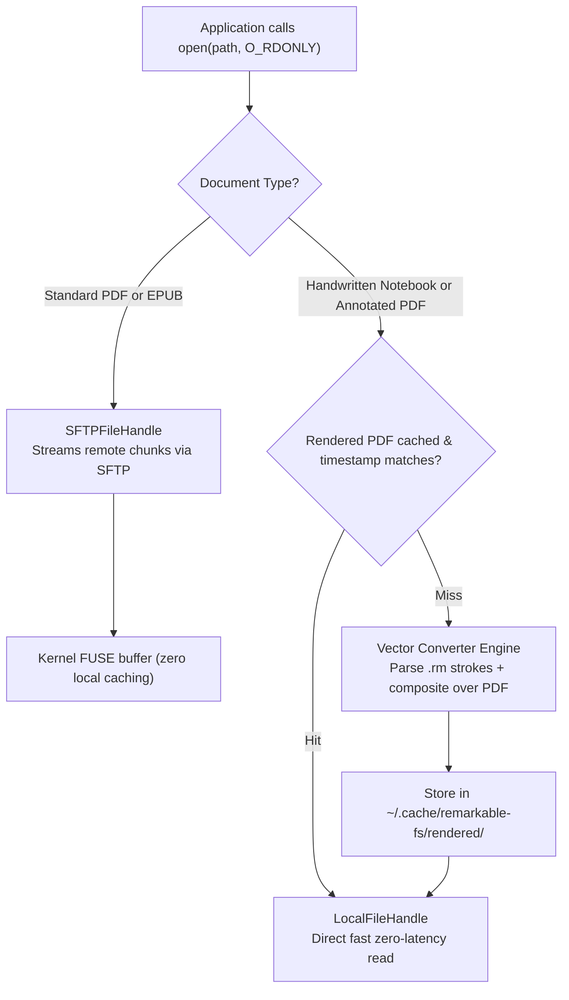
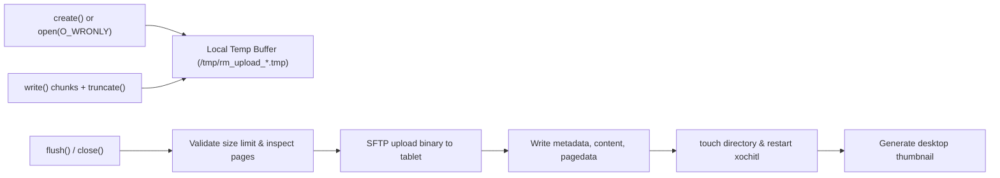

# FUSE Filesystem Architecture & Capabilities

`remarkable-fs` includes a high-performance, bidirectional virtual filesystem layer implemented in [`internal/fusefs`](../internal/fusefs/fs.go). It bridges the user's Linux operating system with the reMarkable tablet, providing native file manager interactions (file browsing, reading, uploading, overwriting, renaming, and deleting) without running any custom software on the tablet itself.

---

## 1. Design Philosophy

Traditional FUSE filesystems in Linux rely on C bindings to `libfuse.so` via CGO. `remarkable-fs` takes a completely different path:

- **Pure Go FUSE Driver**: Built directly upon [`github.com/hanwen/go-fuse/v2`](https://github.com/hanwen/go-fuse), communicating directly with the Linux kernel `/dev/fuse` character device.
- **Zero CGO & Zero C Dependencies**: Produces a static, highly portable binary with no runtime dependencies on `libfuse2` or `libfuse3`.
- **Client-Side Only**: Does not modify the tablet's operating system partitions or require background daemon binaries on the device; all interactions occur through standard POSIX SSH and SFTP protocols.

---

## 2. Virtual Directory Hierarchy

The reMarkable tablet does not store files in nested Unix folders. Instead, `/home/root/.local/share/remarkable/xochitl/` is a flat directory containing hundreds or thousands of files named by UUID (e.g., `<uuid>.metadata`, `<uuid>.content`, `<uuid>.pdf`, `<uuid>/`).

### Tree Reconstruction
When `remarkable-fs` mounts:
1. The repository parses all `<uuid>.metadata` JSON files.
2. Items of type `CollectionType` are instantiated as virtual directories (`model.TypeCollection`).
3. Items of type `DocumentType` are instantiated as virtual files.
4. The parent-child relationships defined by `parent: "<uuid>"` are assembled into an in-memory `model.FSNode` hierarchy. Documents with `parent: ""` reside at the root `/`.
5. Filenames are sanitized for Unix compatibility and disambiguated if duplicate titles exist within the same folder.
6. Inodes are dynamically managed via `DirNode` and `FileNode`.

---

## 3. Reading Operations & Streaming Modes

Reading a file from the virtual mount routes through one of two primary pathways depending on the document type:



### 3.1. Direct SFTP Streaming (`SFTPFileHandle`)
- Used for native unannotated PDF and EPUB files.
- Files are not pre-downloaded to disk. Byte ranges are fetched on-demand using SFTP `ReadAt` requests.
- **Reconnection Resilience**: If an SSH/SFTP connection drops (e.g. tablet momentarily sleeps or Wi-Fi roaming occurs), `SFTPFileHandle.Read` detects the broken pipe, transparently reconnects, reopens the remote file handle at the requested offset, and satisfies the kernel buffer without crashing the calling application.

### 3.2. On-the-Fly Vector Rendering (`LocalFileHandle`)
- Used for:
  1. Pure handwritten notebooks (`.notebook` files, rendered as vector `.pdf`).
  2. Annotated PDFs (documents where handwritten sketches reside in the tablet's `<uuid>/` stroke directory).
- On access, the converter parses the binary `.rm` coordinate streams and converts them into SVG vector layers.
- For annotated PDFs, the converter inspects the base PDF's physical page dimensions (width, height, rotation) and overlays the handwritten annotations with precise mathematical scaling.
- The resulting multi-page vector PDF is written to `~/.cache/remarkable-fs/rendered/{uuid}_{timestamp}.pdf`.
- If the document has not changed on the tablet, subsequent opens hit the local disk cache with near-zero latency.

---

## 4. Writing & Upload Operations

Handling writes to a paper tablet over FUSE presents unique challenges: modern file managers (Nautilus, Dolphin) and shell tools (`cp`, `rsync`, editors) write data in chunks, seek arbitrarily, truncate files, and perform atomic renames through temporary files.

`remarkable-fs` implements a full write-buffering pipeline centered on `UploadFileHandle`.



### 4.1. FUSE Interfaces in Plain English

In `go-fuse`, interface names append `-er` to POSIX system calls. In our codebase, these interfaces correspond to the following responsibilities:

| Interface | Human-Friendly Role | Purpose in `remarkable-fs` |
| :--- | :--- | :--- |
| **`FileWriter`** | Chunk Writer | Receives arbitrary byte chunks and offsets from the kernel and writes them into the local temporary staging buffer. |
| **`FileReader`** | Chunk Reader | Reads back bytes from the staging buffer. Essential for applications that open files in `O_RDWR` (read/write) mode. |
| **`FileSetattrer`** | Size & Attribute Setter | Handles file truncation (`ftruncate`) and size allocations during uploads while strictly enforcing `max_upload_size_mb`. |
| **`FileGetattrer`** | Attribute Inspector | Responds to `fstat()` inquiries with current buffered size and POSIX file modes. |
| **`FileFlusher`** | Flush & Close Committer | Invoked when the application closes its file descriptor. Triggers committing completed uploads to the tablet. |
| **`FileReleaser`** | Cleanup Handler | Frees internal handles and deletes temporary local disk buffers. |

### 4.2. Staging & Atomic Rename Support (Nautilus, Dolphin, `rsync`)
File managers like GNOME Files (Nautilus) and KDE Dolphin never write directly to the target filename. Instead, they:
1. Call `Create(".goutputstream-XXXXXX")` or `Create(".file.pdf.part")`.
2. Write the file contents into the temporary file.
3. Close the temporary file.
4. Call `Rename(".goutputstream-XXXXXX", "Final_Document.pdf")`.

`remarkable-fs` recognizes temporary upload prefixes and suffixes (`isTemporaryUploadName`). It delays the remote tablet SFTP commit while the temporary file is active, and executes the upload atomically inside `DirNode.Rename` once the final filename is confirmed.

### 4.3. In-Place Overwrites (`O_WRONLY | O_TRUNC`)
When a user copies a file over an existing document (`cp new.pdf existing.pdf`):
- `FileNode.Open` catches write flags (`O_WRONLY`, `O_RDWR`, `O_TRUNC`).
- Pure handwritten notebooks reject overwrites with `syscall.EACCES` to prevent accidental destruction of vector notes.
- Supported documents (`.pdf` and `.epub`) allocate an `UploadFileHandle` bound to the existing UUID.
- Any prior handwritten drawing strokes on the tablet (`/home/root/.local/share/remarkable/xochitl/<uuid>/`) and local rendered caches are wiped clean to prevent old annotations from bleeding into the new document.
- Page counts and content descriptors are updated, and fresh desktop thumbnails are generated.

### 4.4. Folder Creation (`DirNode.Mkdir`)
- Invoked when running `mkdir` or creating a new folder in a file manager.
- Allocates a new UUID.
- Writes `<uuid>.metadata` with `"type": "CollectionType"` and the parent folder's UUID.
- Inserts a new `DirNode` into the virtual hierarchy and refreshes the tablet UI.

### 4.5. On-the-Fly Plain Text & Markdown Conversion (`.txt`, `.md` -> `.epub` or `.pdf`)
reMarkable's native document reader (`xochitl`) does not natively support plain text or markdown files. When uploading `.txt` or `.md` files via the FUSE mount, `remarkable-fs` automatically converts them on-the-fly using 100% pure Go libraries:

- **Native EPUB 3 / EPUB 2 Generation (Default)**:
  - Generates standards-compliant EPUB archives using Go's standard library `archive/zip` and `goldmark` with GitHub Flavored Markdown (tables, task lists, code blocks).
  - Designed specifically for an optimal e-reader experience on the reMarkable tablet: reflowable text, adjustable font sizing, margin control, font switching (Serif, Sans), and stylus annotation support.
  - Automatically uploaded with `"fileType": "epub"` and standard e-reader margins (`margins: 125`).
- **Fixed-Layout Vector PDF Generation (Configurable)**:
  - If configured via `text_upload_format: "pdf"` or `--text-format pdf`, uses `codeberg.org/go-pdf/fpdf` to render fixed-layout vector PDFs.
  - Formatted specifically to reMarkable 2's 3:4 screen aspect ratio (158 mm x 210 mm, matching 1404 x 1872 px) using Bigelow & Holmes' embedded Go Font family (`GoSans`, `GoMono`) with hanging indents and orphan header protection.

---

## 5. Clean, Residue-Free Deletion

Deleting documents on reMarkable is notoriously prone to "ghost files" and leftover drawing residues if not handled comprehensively.

### 5.1. Complete Tablet Residue Purging
When `DirNode.Unlink` (file deletion) or `DirNode.Rmdir` (empty folder deletion) executes, `remarkable-fs` executes an atomic cleanup command on the tablet over SSH:

```bash
rm -rf /home/root/.local/share/remarkable/xochitl/<uuid>* \
       /home/root/.local/share/remarkable/xochitl/<uuid> && \
touch /home/root/.local/share/remarkable/xochitl && \
systemctl reset-failed xochitl.service && \
systemctl --no-block restart xochitl
```

This single operation deletes:
1. `<uuid>.metadata` (Document metadata)
2. `<uuid>.content` (Page map & layout settings)
3. `<uuid>.pagedata` (Page templates)
4. `<uuid>.pdf` or `<uuid>.epub` (Binary documents)
5. `<uuid>/` (Handwritten vector stroke `.rm` files)
6. `<uuid>.thumbnails/` (Native tablet page preview PNGs)
7. `<uuid>.highlights/` (Text highlights and selections)

### 5.2. Local Cache Eviction
- Invalidates the rendered PDF cache in `~/.cache/remarkable-fs/rendered/`.
- Deletes the associated FreeDesktop thumbnail in `~/.cache/thumbnails/large/`.
- Removes the node from the in-memory virtual tree and repository index.

### 5.3. Real-Time Tablet UI Synchronization
- Touching the directory timestamp alerts the tablet's file watcher.
- Restarting `xochitl.service` immediately removes the deleted item from the tablet's physical e-ink screen.
- Resetting systemd failed counters (`systemctl reset-failed xochitl.service`) prevents systemd rate-limiting lockouts when multiple operations occur in quick succession.

---

## 6. FreeDesktop Thumbnail Integration

Rather than generating companion `.png` files in the virtual directory (which would clutter folders and confuse users), `remarkable-fs` integrates directly with the **FreeDesktop Thumbnail Management Standard**:

1. Calculates the MD5 hash of the local canonical file URI:
   ```text
   file:///home/user/remarkable/Folder/Document.pdf -> md5 -> 833d3f37d473ee81ce62e7e181eb7339.png
   ```
2. Checks whether a tablet native thumbnail exists (`<uuid>.thumbnails/<page_uuid>.png`) or renders the first page of the PDF to PNG.
3. Injects required FreeDesktop PNG metadata tags (`Thumb::URI`, `Thumb::MTime`).
4. Writes the thumbnail directly to `~/.cache/thumbnails/large/`.
5. Linux file managers (Nautilus, Dolphin, Thunar) automatically display the thumbnail instantly upon navigating into the directory.
